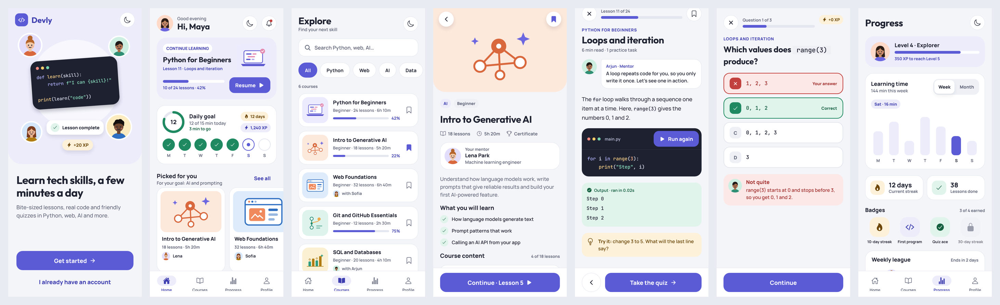
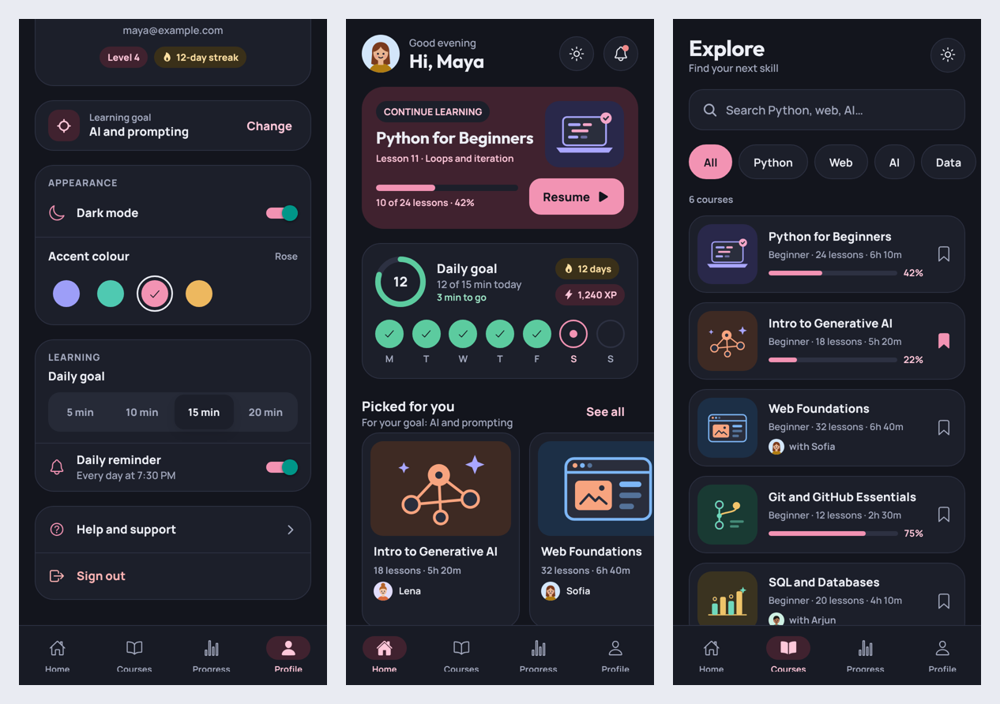

# Devly — tech learning app

A themed, interactive learning app built with **Expo (SDK 57) + React Native + TypeScript**.




## Run it

```bash
npm install
npx expo start
```

Then scan the QR code with **Expo Go** on your phone (Expo Go must support SDK 57), or press `w` to open it in the browser.

Everything the app uses (SVG, AsyncStorage, fonts, navigation) works inside Expo Go — no development build needed.

## What's inside

| Screen | What you can do |
| --- | --- |
| Welcome | Intro with illustrated avatars; toggle light/dark |
| Goals | Pick a learning goal and level (used again from Profile → Change) |
| Home | Continue card, daily-goal ring, weekly streak, "Picked for you" based on your goal |
| Explore | Search, filter by category, save/unsave courses, empty state |
| Course detail | Mentor, outcomes, module progress (done / current / locked), save |
| Lesson | Mentor tip, code block with a working **Run** button, practice tip, bookmark |
| Practice | Languages grid, per-language topic practice, Master Quiz (70% to pass, 100 XP once), Dashboard analytics and Certificates (PDF download) |
| Progress | Level, week/month chart (tap a bar), streak, badges, weekly league |
| Profile | Change avatar, dark mode, 4 accent colours, daily goal, reminders, sign out |

Your choices (theme, accent, goal, saved courses, avatar…) are saved on the device with AsyncStorage, so they survive app restarts. By default the app follows the phone's light/dark setting until you toggle it.

## Project structure

```
App.tsx                      fonts, providers, navigation container
src/
  theme/palette.ts           light/dark colours, accent colours, course tile colours
  theme/fonts.ts             font family names (Outfit, Manrope, JetBrains Mono)
  context/AppContext.tsx     saved preferences + useApp(), useColors(), useStyles()
  data/                      courses, lessons, practice questions and logic (practice.ts), progress, people
  components/                Avatar, CourseArt, Txt, Screen, buttons, chips, progress…
  navigation/                stack + bottom tabs (React Navigation 7)
  screens/                   one file per screen
```

### Theming pattern

Every screen builds its styles from the current colours:

```tsx
const s = useStyles(makeStyles);           // inside the component
const makeStyles = (c: Colors) => StyleSheet.create({ card: { backgroundColor: c.surface } });
```

Change a colour in `src/theme/palette.ts` and it updates everywhere, in both themes.

### Changing content

- Courses, goals and modules: `src/data/courses.ts`
- Lessons: `src/data/lessons.ts`. Practice questions: `src/data/quizzes.ts` and `src/data/quizExtras.ts`. Practice logic and certificates: `src/data/practice.ts`.
- Tests: `npm test` (practice logic, certificates, PDF template escaping).
- Avatars and mentors: `src/data/people.ts`

All data is sample data, ready to be replaced by API calls (for example a Flask backend).
